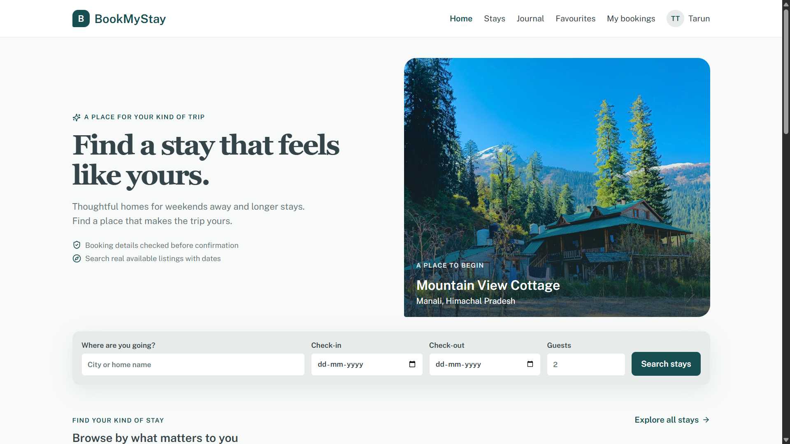
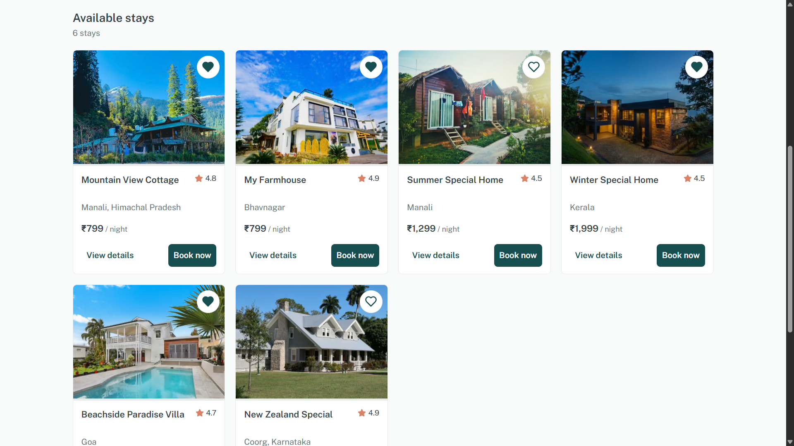
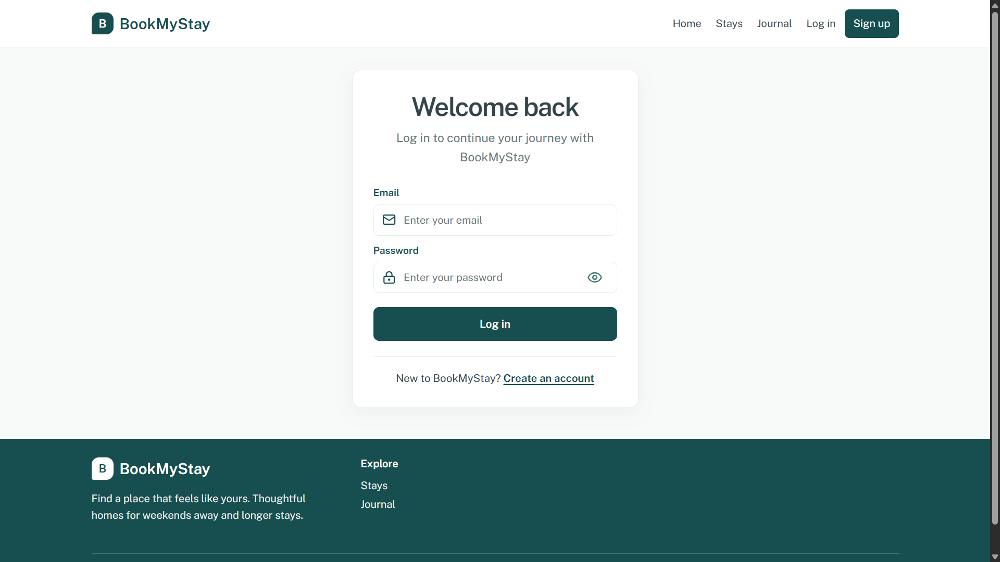
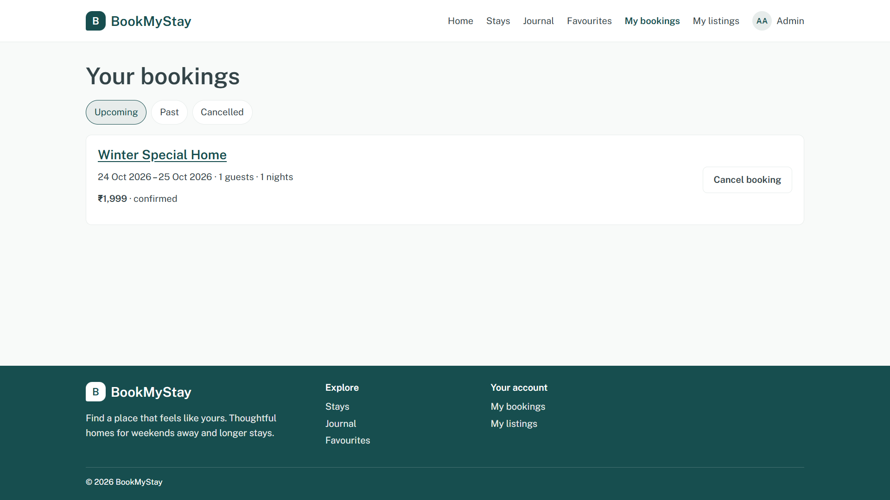
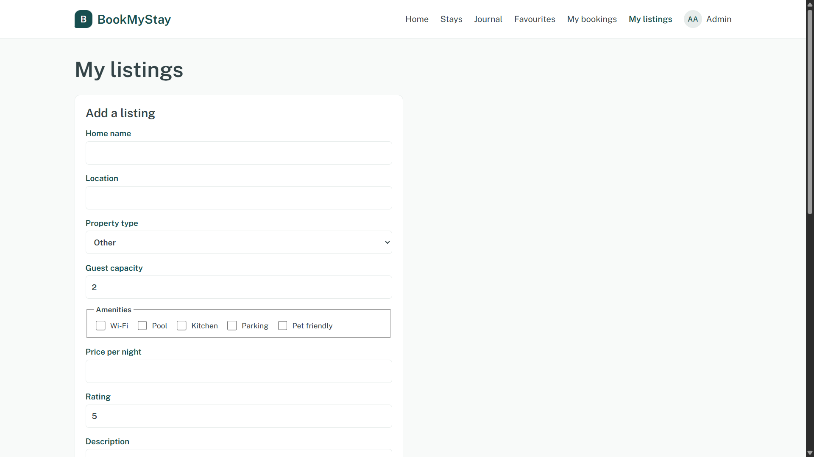

# BookMyStay 🏡

### Find a stay that feels like yours.

BookMyStay is a full-stack property booking web application that allows users to discover places to stay, explore property details, manage favourites, and book accommodations. It also enables property owners to create and manage their listings through a simple interface.

The application combines a React frontend with a Node.js and Express backend, using MongoDB to store application data.

**🌐 Live Demo:** [BookMyStay](https://bookmystay-m1dn.onrender.com)

**💻 Repository:** [GitHub](https://github.com/tarun0001g/BookMyStay)

---

## 📸 Application Preview

### Home Page
Explore available properties, discover destinations, and search for stays based on location and travel dates.



### Available Stays
Browse properties with images, ratings, locations, and prices.



### User Authentication
Create an account or log in to access personalized features.



### My Bookings
View upcoming, past, and cancelled bookings and manage reservations.



### My Listings
Create, edit, and manage your property listings.



> **Note:** Save your screenshots in the existing `screenshots` directory using the filenames shown above, or update the image paths to match your actual filenames.

---

## ✨ Features

### 🏠 Property Discovery
- Browse available accommodations.
- View property images, descriptions, locations, prices, and ratings.
- Search for properties by city or property name.
- Filter stays using available categories and amenities.
- View detailed property information before booking.

### 🔐 User Authentication
- User registration and login.
- Secure password handling.
- Session-based authentication.
- Protected routes for authenticated users.
- Access control for user-specific features.

### 📅 Booking Management
- Book available properties.
- Manage upcoming bookings.
- View past and cancelled reservations.
- Cancel eligible bookings.
- View booking details, dates, guest count, and booking status.

### ❤️ Favourites
- Add properties to your favourites.
- Remove properties from your favourites.
- View saved properties in one place.

### 🏡 Property Management
- Create property listings.
- Upload property images.
- Add property details, amenities, and pricing.
- Edit existing listings.
- Delete listings when required.
- Manage your own properties.

### 👤 User Experience
- Responsive and modern interface.
- Property cards with clear pricing and ratings.
- Consistent navigation across the application.
- Dedicated pages for bookings, favourites, and listings.

---

## 🛠️ Tech Stack

| Category | Technologies |
|---|---|
| Frontend | React.js, HTML5, CSS3, JavaScript |
| Frontend Build Tool | Vite |
| Backend | Node.js, Express.js |
| Database | MongoDB |
| ODM | Mongoose |
| Authentication | Session-based authentication |
| Image Handling | Multer and configured image storage |
| Architecture | Model-View-Controller (MVC) |
| Deployment | Render |
| Version Control | Git and GitHub |

---

## 🏗️ Application Architecture

BookMyStay follows an MVC-oriented backend structure, separating application routes, controllers, models, middleware, and supporting utilities.

The React frontend communicates with the Express application, which processes requests and interacts with MongoDB.

```text
                 ┌──────────────────────┐
                 │        User          │
                 └──────────┬───────────┘
                            │
                            ▼
                 ┌──────────────────────┐
                 │   React + Vite       │
                 │      Frontend        │
                 └──────────┬───────────┘
                            │
                            ▼
                 ┌──────────────────────┐
                 │    Express.js        │
                 │    Application       │
                 └──────────┬───────────┘
                            │
                 ┌──────────┼───────────┐
                 │          │           │
                 ▼          ▼           ▼
            Middleware  Controllers   Routes
                 │          │           │
                 └──────────┼───────────┘
                            │
                            ▼
                 ┌──────────────────────┐
                 │   Mongoose Models    │
                 └──────────┬───────────┘
                            │
                            ▼
                 ┌──────────────────────┐
                 │      MongoDB         │
                 └──────────────────────┘
```

### Key Implementation Concepts

- **MVC Architecture:** Separates application responsibilities into organized modules.
- **RESTful Routing:** Handles requests through dedicated Express routes.
- **Middleware:** Supports request processing, authentication, and other shared operations.
- **Database Modeling:** Uses Mongoose schemas and models to work with MongoDB.
- **Authentication and Authorization:** Controls access to protected application features.
- **CRUD Operations:** Supports creating, reading, updating, and deleting property listings.
- **File Uploads:** Handles property image uploads.

---

## 📂 Project Structure

```text
BookMyStay/
│
├── client/
│   ├── dist/                 # Production frontend build
│   ├── src/                  # React application source
│   ├── index.html
│   ├── vite.config.js
│   └── package.json          # If present in your client setup
│
├── config/                   # Application configuration
├── controllers/              # Request handling logic
├── docs/                     # Project documentation
├── middleware/               # Custom middleware
├── models/                   # Mongoose models
├── routes/                   # Express routes
├── rules/                    # Application rules
├── screenshots/              # Application screenshots
├── scripts/                  # Utility scripts
├── tests/                    # Tests
├── uploads/                  # Uploaded files, if stored locally
├── utility/                  # Shared utility functions
├── validators/               # Input validation
│
├── app.js                    # Express application entry point
├── package.json              # Backend dependencies and scripts
├── package-lock.json
├── .env.example              # Environment variable template
├── .gitignore
└── README.md
```

*The structure above highlights the main directories. Some files and directories may differ depending on your current setup.*

---

## 🚀 Getting Started

Follow these steps to run BookMyStay locally.

### Prerequisites

Install the following:

- [Node.js](https://nodejs.org/)
- npm, included with Node.js
- A MongoDB database, either local or hosted

### 1. Clone the Repository

```bash
git clone https://github.com/tarun0001g/BookMyStay.git
```

Navigate into the project directory:

```bash
cd BookMyStay
```

### 2. Install Backend Dependencies

```bash
npm install
```

### 3. Configure Environment Variables

Create a `.env` file in the project root using `.env.example` as your reference.

```env
MONGO_URL=your_mongodb_connection_string
```

Add any other environment variables required by your application, using the exact names defined in your configuration.

**Important:** Never commit your actual `.env` file, database credentials, session secrets, or other sensitive values to GitHub.

### 4. Install Frontend Dependencies

Navigate to the client directory:

```bash
cd client
npm install
```

Return to the project root after installation:

```bash
cd ..
```

### 5. Start the Application

To run the backend in development mode:

```bash
npm run dev
```

If your project uses a different development script, use the command defined in the root `package.json`.

To start the application using its production start script:

```bash
npm start
```

Open the local URL configured by your application in your browser.

---

## 🌐 Deployment

BookMyStay is deployed on Render.

**Live Application:** [https://bookmystay-m1dn.onrender.com](https://bookmystay-m1dn.onrender.com)

The application uses a production build of the React frontend, served by the Express backend.

### Render Configuration

**Build Command**

```bash
npm install --include=dev && npm run build
```

**Start Command**

```bash
npm start
```

The build command installs development dependencies required by Vite and generates the production frontend files.

Make sure the production build creates:

```text
client/dist/index.html
```

Configure the required environment variables in the Render dashboard before deploying.

---

## 🔒 Security Considerations

The application includes authentication and access-controlled features.

Security-related implementation areas include:

- Password handling and authentication.
- Session management.
- Protected routes.
- Authorization for user-specific actions.
- Server-side request validation.
- Environment-based configuration.

Sensitive credentials should remain outside the source code. Protected operations should always be validated on the server rather than relying only on frontend restrictions.

---

## 🧪 Testing

The project includes a `tests` directory for testing-related code.

When making changes, verify the following application workflows:

- User registration and login.
- Property browsing and search.
- Creating and managing favourites.
- Creating and cancelling bookings.
- Creating, editing, and deleting property listings.
- Access to protected routes.
- Frontend production build.
- Application startup and deployment.

Run any available automated tests using the scripts defined in `package.json`.

---

## 🔮 Future Improvements

Potential enhancements for future versions include:

- Advanced property search and filtering.
- Improved booking availability management.
- Online payment integration.
- Property reviews and user feedback.
- Email notifications for bookings.
- Improved administrative dashboard.
- More comprehensive automated testing.
- Enhanced performance and accessibility.

---

## 👨‍💻 Author

**Tarun Makwana**

B.Tech in Information Technology

- GitHub: [tarun0001g](https://github.com/tarun0001g)
- Portfolio: [View Portfolio](https://tarun-portfolio-beta-three.vercel.app/)

---

⭐ If you find this project interesting, consider giving the repository a star!

**BookMyStay — Find a stay that feels like yours.**